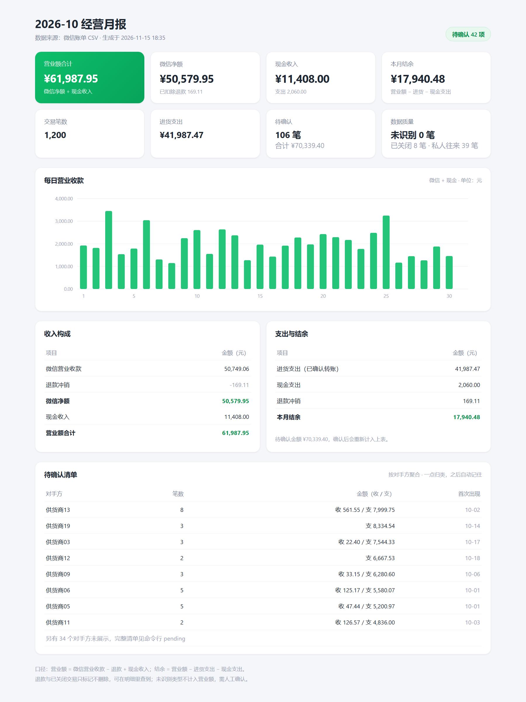
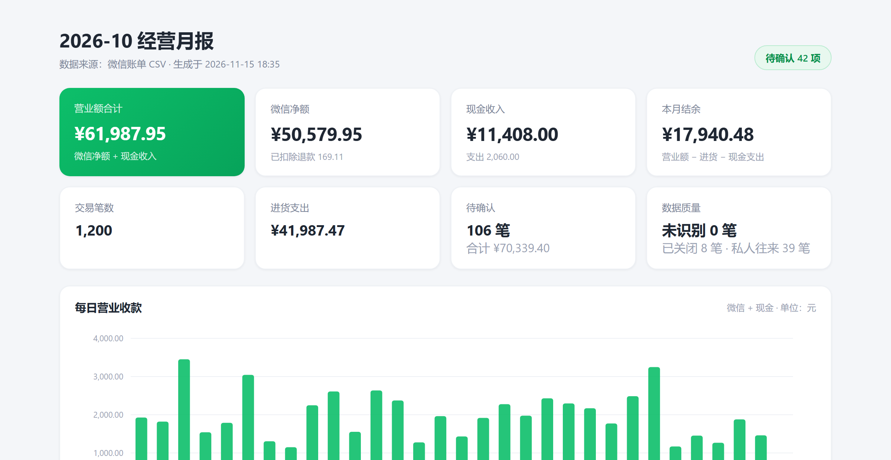

# 个人商户记账工具

> 把微信导出的账单，变成一张能看清「这个月生意收了多少、花了多少、有没有哪笔没收着」的表。



小微零售店最典型的记账方式是：不记账。顾客扫码付款，听到语音播报「微信收款 12 元」，就算收了。
月底想算清楚赚了多少，只能打开微信账单往下翻，一边翻一边判断哪些是生意款、哪些是家人转来的钱。

这个工具要解决的问题只有一个：**把混在同一个微信号里的生意款和私人款分开，还算清楚营业额。**

---

## 当前状态

| 模块 | 状态 |
|---|---|
| 账单解析（容错读表、金额清洗、三态分类、退款剔除、手续费提取） | 完成 |
| 对手方记忆库（一个陌生昵称只问一次） | 完成 |
| 现金补录（按天、支持收入与支出） | 完成 |
| 经营月报（Markdown / 自包含 HTML / 五张 CSV） | 完成 |
| 命令行（导入 / 待确认 / 确认 / 现金 / 报表 / 导出 / 清空） | 完成 |
| 小程序后端（FastAPI + 云托管 + MySQL，按 openid 隔离数据） | 接口完成，已部署，MySQL 数据层就绪 |
| 微信小程序前端 | 初版完成（导入 / 待确认 / 月报），等 ICP 备案后提审 |

```bash
pip install -r requirements.txt
pytest -q                      # 85 passed
```

实测：3 万行账单解析 **0.33 秒**（纯标准库，无 pandas）。

---

## 和已有的账单工具有什么不同

GitHub 上同类项目至少 5 个，功能高度重合：

| 项目 | 做的是什么 |
|---|---|
| [小遥账单助手](https://github.com/dtsola/xiaoyaoprivatebill) | 个人账单可视化 |
| [payment_record_analysis](https://github.com/Hessel2333/payment_record_analysis) | 个人消费画像 |
| [personal-finance-cn](https://github.com/Allen091080/personal-finance-cn) | 用大模型给个人消费分类 |
| [double-entry-generator](https://github.com/deb-sig/double-entry-generator) | 账单转复式记账凭证 |

它们都在回答「我这个月花了多少」。这个项目回答的是另一个问题：

| | 个人消费分析 | 本项目 |
|---|---|---|
| 最大障碍 | 商户名看不懂 | 生意款与私人款混在同一个微信里 |
| 必须处理 | 分类占比、趋势图 | 退款、抹零、提现手续费、现金 |
| 失败代价 | 图表不准 | 钱少了不知道 |

---

## 核心设计：不确定就让人定，然后记住

月流水几千到几万笔，逐笔确认是不可能完成的：

1. **柜台收款码的流水全部自动判定**——交易类型是「二维码收款」，100% 是营业款
2. **只有「转账」需要人工判断**——可能是顾客、亲友、退货返款
3. **按对手方聚合，不按笔**——一个陌生昵称只问一次

合成样本（3 万行，seed=42）实测：3,191 笔待确认转账聚合后只有 **54 个对手方**，压缩 59 倍。
用户要点的是 54 次，不是 3,191 次。确认过的对手方写入 SQLite 记忆库，下次导入自动归类。

---

## 报表口径

这是整个项目最容易算错的地方，所以口径只有一套，写在 `app/report.py` 顶部：

```
微信营业收款 = BUSINESS_INCOME 且未被剔除的金额合计
微信净额     = 微信营业收款 − 退款冲销
营业额       = 微信净额 + 现金收入
结余         = 营业额 − 进货支出 − 现金支出
```

三个必须分开的概念：

| 概念 | 说明 |
|---|---|
| `income_total` | 所有「收入」方向的金额。**包含红包、赞赏、待确认转账，不能当营业额** |
| `refund_total` | 退款行的金额。退款行的类型是「二维码收款」但方向是**支出**，不减掉营业额就虚高 |
| `business_income_total` | 真正能进营业额的营业收款 |

> 报表里的「退款冲销」只减**营业类**退款（二维码收款/群收款/已确认的顾客转账）。
> 买件衣服的退款、红包退还和生意无关，不会让当月营收变少。

真实样例里 `income_total = 28.49`，但其中只有 **23.00** 是二维码收款——剩下 5.49 是红包、打赏和两笔充值。

---

## 快速开始

没有真实账单也能先跑通。生成三个月的模拟数据（格式与真实导出一致，可复现）：

```bash
python scripts/gen_realistic.py --months 3 --per-month 900 --out samples
python -m app.cli import --file samples/微信支付账单_2026-10.csv
```

模拟数据覆盖近 20 种交易类型（二维码收款、群收款、转账、红包、提现、零钱通、信用卡还款、
亲属卡、赞赏码、退款、已关闭、未知类型等），并保证每月至少出现一条退款、关闭、手续费与未知类型。

拿到账单后，完整流程：

```bash
# 1. 导入微信账单 CSV（原始文件解析后即可删除）
python -m app.cli import --file 账单.csv

# 2. 看待确认清单（按对手方聚合，金额排序）
python -m app.cli pending

# 3. 确认一个陌生对手方：顾客 / 进货 / 私人
python -m app.cli confirm --peer 张三 --as business_income
python -m app.cli confirm --peer 批发市场 --as business_expense
python -m app.cli confirm --peer 老同学 --as private

# 4. 现金补录：一天一个数字，支持支出
python -m app.cli cash set 2026-10-31 380
python -m app.cli cash set 2026-10-31 120 --expense --note 批发市场进货
python -m app.cli cash list --month 2026-10

# 5. 出月报：终端 + Markdown + 自包含 HTML
python -m app.cli report --month 2026-10 --html 月报.html --md 月报.md

# 6. 导出五张 CSV（营业收款 / 进货支出 / 私人往来 / 未识别 / 退款与关闭）
#    Excel 双击可开，金额是数字不是文本
python -m app.cli export --month 2026-10 --dir out
```



[点击查看完整月报示例](docs/demo-report.html)（示例数据由 `scripts/gen_synthetic.py` 生成，不含任何真实账单）

### 小程序本地预览

1. 微信开发者工具 → 导入项目 → 选择仓库里的 `miniprogram` 目录
2. AppID 已写在 `project.config.json`（`wx43a0ebc2ea23b96a`）
3. 改 [miniprogram/config.js](miniprogram/config.js) 里的 `envId` 为你的云托管环境 ID
4. 详情 → 本地设置 → 勾选「不校验合法域名」（`callContainer` 不依赖域名，勾上少踩坑）
5. 编译后即可在模拟器里选文件、看待确认、出月报

---

## 账单从哪来

微信 App：`我 → 服务 → 钱包 → 账单 → 右上角「…」→ 常见问题 → 下载账单 → 用于个人对账`

导出的是加密 zip（密码为微信号后六位），里面是 CSV。注意手机端解压带密码的 zip 有摩擦，
PC 端解压后再转发到「文件传输助手」是最稳的路径。

这个格式的坑已经逐条记录在 [docs/bill-format.md](docs/bill-format.md)：表头不在第一行、UTF-8 BOM、
字段尾部带 TAB、金额带 `¥`、小数位不统一、退款是新增一行而不是修改原行。

---

## 目录结构

```
app/
  wechat/parser.py           容错解析：定位表头、金额清洗、三态分类、退款剔除
  wechat/memory.py           对手方记忆库（SQLite）
  wechat/reconcile.py        待确认按对手方聚合
  cash.py                    现金补录（金额存「分」，整数）
  store.py                   交易持久化（SQLite / MySQL 自动切换，复合键幂等）
  db.py                      数据库适配层（本地 SQLite，云端 MySQL）
  report.py                  报表口径与渲染（Markdown / HTML / CSV）
  cli.py                     命令行入口
  api.py                     FastAPI 接口（小程序云托管用，按 openid 隔离）
miniprogram/                 小程序前端（原生 WXML）
  config.js                  云托管环境 ID 与服务名，只改这里
  pages/                     导入 / 待确认 / 月报
tests/
  test_parse_wechat.py       30 项契约测试（断言来自对抗性样例实测）
  test_memory.py             记忆库与待确认聚合
  test_report.py             现金、幂等、报表口径
  test_api.py                接口鉴权与多用户隔离
scripts/gen_synthetic.py     合成样本生成器（seed 固定，可复现）
scripts/gen_realistic.py     真实节奏的模拟账单生成器（多月份、近 20 种交易类型）
fixtures/wechat-sample-real.csv  对抗性样例，27 行 / 18 种交易类型
docs/                        格式说明、逐函数规格、部署方案、示例月报
```

---

## 已知边界

- **样例数据不是真实账单**：`fixtures/wechat-sample-real.csv` 来自开源项目
  `double-entry-generator` 的**对抗性测试样本**，覆盖了大量异常场景，但不是真实店铺流水。
  3 万行压力样本由脚本确定性生成。README 里所有「实测」数字都可以用 `scripts/gen_synthetic.py` 复现。
- **跨月退款**：退款行落在退款发生的月份，原交易可能在上个月。单月报表按交易时间归属，
  全年合计正确，单月会有偏差；目前未做退款与原单的配对。
- **提现手续费**只做统计（`fee_total`），没有并入结余——提现是中性交易，钱只是换了地方。
- **未做**：赊账、库存、发票、报税、多店铺、员工分账。

---

## 隐私

账单是敏感数据。当前版本是**纯本地命令行工具**：不联网、不上传，数据只存在本机 `data/`
（已在 `.gitignore`），`python -m app.cli clear --yes` 一键清空。
小程序版本的数据流向与隐私设计见 [docs/deploy.md](docs/deploy.md)。

---

## 文档

| 文件 | 内容 |
|---|---|
| [docs/bill-format.md](docs/bill-format.md) | 微信账单格式逐条实测 |
| [docs/spec.md](docs/spec.md) | 产品规格与取舍 |
| [docs/deploy.md](docs/deploy.md) | 小程序 + 云托管部署方案（含 ICP 备案前置） |
| [docs/demo-report.html](docs/demo-report.html) | 完整月报示例 |

## License

[MIT](LICENSE)
